<!-- Batman / Gotham profile theme for Coder-Adi12 -->

  
  <h1>ADITYA BORHADE</h1>
  <h3>AI / ML • SOFTWARE DEVELOPMENT • FULL-STACK BUILDER</h3>
  
<strong>Learning. Building. Shipping.</strong>

  
I explore how intelligent systems work, build useful software, and turn ideas into practical projects.

  
  
  

---

## 🦇 The Mission

I'm **Aditya Borhade**, a Computer Engineering student building across **AI/ML, generative AI, and modern web development**. I enjoy learning the fundamentals behind a system, implementing what I learn, and documenting the results clearly.

- **AI & machine learning:** regression, classification, data analysis, and model evaluation.
- **Generative AI:** exploring tokenizers, attention, Transformer blocks, and small GPT-style models.
- **Web engineering:** building React/TypeScript experiences and connecting them to backend services.
- **Build mindset:** practical projects, measurable results, readable code, and steady improvement.

> *Gotham has a signal. I have a terminal.*

## ⚡ Featured Projects

<table>
<tr>
<td width="50%" valign="top">
<h3>🧠 <a href="https://github.com/Coder-Adi12/neetcode-gpt">My GPT — Built from Scratch</a></h3>
A learning project progressing from neural-network foundations to a GPT-style model.
  
Attention · Transformers · Tokenization · Python
</td>
<td width="50%" valign="top">
<h3>🔥 <a href="https://github.com/Coder-Adi12/Babygpt">BabyGPT</a></h3>
A compact language-model experiment with custom tokenization and decoder components.
  
BPE Tokenizer · Multi-Head Attention · KV Cache
 Repository documents a 5.28M-parameter model.
</td>
</tr>
<tr>
<td width="50%" valign="top">
<h3>🎙️ <a href="https://github.com/Coder-Adi12/RUSBORN">RUSBORN — Voice AI</a></h3>
Voice-agent project using LiveKit Agents and LiveKit Cloud with connected backend components.
  
Voice AI · Python · LiveKit · Supabase
</td>
<td width="50%" valign="top">
<h3>🏠 <a href="https://github.com/Coder-Adi12/House-Price-Prediction">House Price Prediction</a></h3>
Ames housing regression with preprocessing, feature engineering, and model comparison.
  
Pandas · scikit-learn · Ridge · Lasso
 Repository reports a Kaggle test RMSE of 0.14139.
</td>
</tr>
<tr>
<td width="50%" valign="top">
<h3>❤️ <a href="https://github.com/Coder-Adi12/HeartDiseasePrediction">Heart Disease Prediction</a></h3>
Classification workflow comparing Logistic Regression and Decision Tree, with EDA and evaluation metrics.
  
Python · EDA · scikit-learn · Classification
 Repository reports 85.37% test accuracy for Logistic Regression.
</td>
<td width="50%" valign="top">
<h3>🩺 <a href="https://github.com/Coder-Adi12/DiabetesPrediction">Diabetes Prediction</a></h3>
Baseline classification project using the Pima Indians Diabetes dataset.
  
Python · NumPy · Pandas · scikit-learn
</td>
</tr>
<tr>
<td width="50%" valign="top">
<h3>🌌 <a href="https://github.com/Coder-Adi12/Orbit-X-Studios">Orbit-X Studios</a></h3>
Modern interactive web application using a React-based TypeScript stack.
  
React · TypeScript · Vite · Tailwind CSS
</td>
<td width="50%" valign="top">
<h3>🎓 <a href="https://github.com/Coder-Adi12/LotusEnglishAcedemy">Lotus English Academy</a></h3>
Responsive academy website with English/Marathi content, gallery sections, and WhatsApp inquiries.
  
React · TypeScript · Tailwind CSS · Vite
</td>
</tr>
<tr>
<td width="50%" valign="top">
<h3>💻 <a href="https://github.com/Coder-Adi12/neetcode-submissions">NeetCode Submissions</a></h3>
Coding-practice solutions synced and organized by topic and problem.
  
Problem Solving · DSA Practice · GitHub Sync
</td>
<td width="50%" valign="top">
<h3>🌐 <a href="https://github.com/Coder-Adi12/My-Portfolio">My Portfolio</a></h3>
My personal portfolio repository for an introduction, selected work, and contact information.
  
HTML · CSS · Responsive Design
</td>
</tr>
</table>

## 🧰 Tech Stack

### Languages

### Web & Backend

### AI / Data & Tools

## 📊 Batcomputer Telemetry

 

 

GitHub stats and activity graphs are hosted by third-party services and may occasionally be delayed or unavailable.

## 🛰️ Future Scope

- Build more complete AI applications, from data preparation to deployment.
- Deepen understanding of neural networks, Transformers, and model evaluation.
- Ship reliable full-stack products with clean interfaces and useful documentation.
- Keep practising data structures, algorithms, and software engineering fundamentals.

## 📡 Find Me Online

  
<strong>The night is dark. The build is always running.</strong>
 
Made with curiosity, coffee, and a little Gotham energy. 🦇

